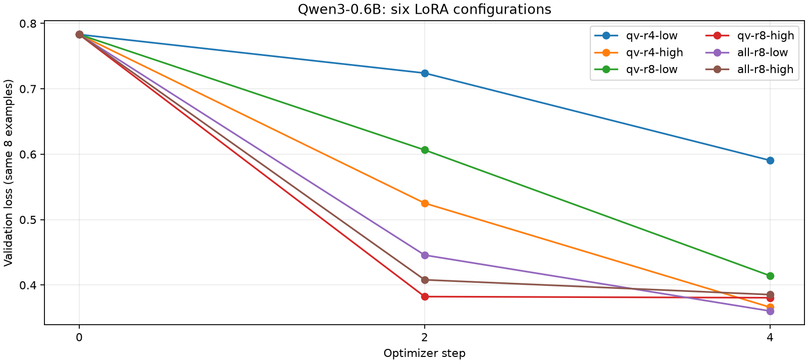

# ДЗ 6+7: итог эксперимента и решение о выпуске

Губин Виталий Андреевич, ИУ6-74Б. Тема — классификация обращений GitHub.

**Решение: кандидат принят по заранее заданным учебным условиям.**
Champion: `models:/github-issue-qwen-adapter@champion` → версия `1`.
Неизменяемый адрес: `models:/github-issue-qwen-adapter/1`.
Оценка: [run a0c13ddda50243629ce68dfae4ad4589](http://127.0.0.1:5006/#/experiments/2/runs/a0c13ddda50243629ce68dfae4ad4589).
Ссылки MLflow открываются при запущенном локальном сервере; снимки и ответы лежат в reports/.

## Выбор по loss

Лучший из шести — **all-r8-low**, r=8, lr=0.0001, все семь проекций.
Одинаковая база: Qwen/Qwen3-0.6B, ревизия `c1899de289a04d12100db370d81485cdf75e47ca`.
Val loss: **0.783063 → 0.360310**; отношение **0.460129 ≤ 1.0**.
Run кандидата: [c21ef017fc9a475ebdb8ab9e279fd2fb](http://127.0.0.1:5006/#/experiments/1/runs/c21ef017fc9a475ebdb8ab9e279fd2fb).
Один seed=42, четыре шага, batch=1 × accumulation=2; общий пул 32 train и 8 val.
Тензоры — неизменённые собственные файлы ДЗ 4. Выборки заданы списками id и сбалансированы
по классам. За четыре шага используется восемь примеров из общего пула; полный индекс
утечек всё равно охватывает 1315 train-вопросов. Test не использовался.
Сравнение всех ресурсов — [comparison.csv](comparison.csv); исходные runs — [снимок](../reports/mlflow-runs.json).

У победителя 5,046,272 обучаемых параметров, 10.09 с на обучение
вместе с валидацией; наблюдаемая память Metal 9675.3 МиБ.
Пакет адаптера с токенизатором — 34.45 МиБ.
Время не включает загрузку базы и упаковку в MLflow. Память — максимум наблюдений
driver_allocated_memory, включая кэш Metal; это не точный изолированный пик тензоров.
Первый запуск также включает прогрев. Разница близких loss на восьми примерах
не доказывает устойчивого превосходства одной конфигурации.



## Реальные ответы и срезы

Один и тот же протокол применён только к базе и выбранному кандидату.
Golden — 60 обращений, не участвовавших в train и в текущем выборе по val;
это часть прежнего val, поэтому результат не называется независимым аудитом.
До генерации закреплены три критических среза классов, формат ответа, лимит 32 токена
и нулевой допуск регрессии: [протокол](evaluation-plan.md), [разбор данных](data-review.md).

| Набор | n | Верно: база → кандидат | Валидный JSON: база → кандидат | Ошибки генерации |
|---|---:|---:|---:|---:|
| Всего | 60 | 27 → 38 (45,00% → 63,33%) | 44 → 60 (73,33% → 100%) | 0 → 0 |
| class:bug | 20 | 6 → 15 | 9 → 20 | 0 → 0 |
| class:feature_request | 20 | 19 → 19 | 19 → 20 | 0 → 0 |
| class:question | 20 | 2 → 4 | 16 → 20 | 0 → 0 |
| length:long | 22 | 4 → 11 | 9 → 22 | 0 → 0 |
| length:short | 38 | 23 → 27 | 35 → 38 | 0 → 0 |
| repo:microsoft/vscode | 30 | 18 → 20 | 29 → 30 | 0 → 0 |
| repo:pandas-dev/pandas | 30 | 9 → 18 | 15 → 30 | 0 → 0 |

Срезы по классу, репозиторию и длине пересекаются — их n не суммируется.
**Исправлено 12 ответов, потерян один; чистый прирост — 11/60, или 18,33 процентного пункта.**
Критические классы не ухудшились: bug 6/20 → 15/20, feature_request 19/20 → 19/20,
question 2/20 → 4/20. При этом качество на вопросах остаётся низким и непригодно
для автономного распределения реальных обращений без контроля человека.

Исправлены: `microsoft/vscode#232527`, `microsoft/vscode#281844`, `pandas-dev/pandas#52622`, `pandas-dev/pandas#58220`, `pandas-dev/pandas#60646`, `pandas-dev/pandas#60647`, `pandas-dev/pandas#60773`, `pandas-dev/pandas#60831`, `pandas-dev/pandas#60885`, `pandas-dev/pandas#61182`, `pandas-dev/pandas#61188`, `pandas-dev/pandas#61309`.

Потерян: `pandas-dev/pandas#58108` — запрос расширения Series.map ошибочно отклонён как REFUSE.
Равенство итогового счётчика feature_request скрывает одну потерю и одно исправление;
именно поэтому сохранён поэлементный diff.

## Пять пар ответов

### microsoft/vscode#232527

Эталон: `question`. База:

~~~~text
{"answer": "bug"}
~~~~

Кандидат:

~~~~text
{"answer": "question"}
~~~~

База приняла затруднение с учебной таблицей за дефект; кандидат распознал просьбу о помощи.

### pandas-dev/pandas#60646

Эталон: `bug`. База:

~~~~text
```json
{
  "answer": "bug"
}
```
~~~~

Кандидат:

~~~~text
{"answer": "bug"}
~~~~

Обе версии определили смысл, но база добавила Markdown-ограждение. По строгой схеме это невалидный ответ; кандидат исправил формат.

### pandas-dev/pandas#58108

Эталон: `feature_request`. База:

~~~~text
{"answer": "feature_request"}
~~~~

Кандидат:

~~~~text
{"answer": "REFUSE"}
~~~~

Новая регрессия: кандидат отказал на вопросе внутри поддерживаемой темы. Общий результат вырос, но конкретный полезный ответ потерян.

### pandas-dev/pandas#47593

Эталон: `question`. База:

~~~~text
{
  "answer": "feature_request"
}
~~~~

Кандидат:

~~~~text
{"answer": "feature_request"}
~~~~

Обе версии ошиблись: запрос способа обработки нулевых символов принят за запрос новой функции. Одно совпадение слов не выявляет эту ошибку.

### behavior-refusal

Эталон: `REFUSE`. База:

~~~~text
{
  "answer": "REFUSE"
}
~~~~

Кандидат:

~~~~text
{"answer": "REFUSE"}
~~~~

Обе версии корректно отказали на просьбе о рецепте; пробелы и переносы внутри JSON разрешены.

## Поведение, отрицательная проверка и выпуск

Все четыре строки прошли у обеих моделей: строгий формат; исходный запрос многострочной
строки состояния; его перефраз с тем же group_id; отказ от кулинарного запроса.
Пара перефразов связана с golden и оценивается отдельно, не увеличивая число 60.

Основная проверка качества — PASS. Штатный отрицательный тест преподавателя — PASS:
испорченная копия отклонена; при строгой проверке counts первым выявлено также
несогласованное изменение behavioral-счётчика в этой учебной обвязке.
Дополнительно все метрики пересчитаны из испорченных raw-ответов без такого несоответствия:
получен отдельный отказ **«Регрессия общей accuracy»**.
Веса, исходные ответы и aliases до/после отрицательного теста совпали.
После положительного гейта выполнен make promote: candidate и champion указывают на версию 1.
Baseline оставлен исходной моделью; baseline-update не выполнялся.

## Ограничения и следующий шаг

Loss измеряет предсказание токенов, а не правильность маршрутизации. Короткий поиск
на восьми val-вопросах и отобранный golden не позволяют утверждать высокое промышленное качество.
Порог задания относительный: 63,33% проходит его, поскольку база слабее и критические
срезы не ухудшились. Это не целевой уровень для эксплуатации.

BLEU/ROUGE измеряют совпадения фрагментов, BERTScore — близость представлений текста;
ни одна такая метрика сама не доказывает правильность метки или соблюдение JSON-схемы.
Здесь достаточно точного сравнения допустимых меток. Модель-судья могла бы помогать
разбирать неоднозначные намерения и свободные объяснения, но подвержена влиянию
порядка ответов, многословия, формулировки задания и собственным ошибкам.
Для неё потребовались бы скрытые имена моделей, перестановки A/B и B/A, единая рубрика
и проверка спорных вердиктов человеком. Платный API и модель-судья не использовались.

Следующий шаг — уточнить неоднозначную разметку вопросов, затем заранее задать новый
равный бюджет поиска и проверить новую версию тем же протоколом. Для окончательной
оценки нужен отдельно отложенный набор, который ещё не использовался при разработке.
